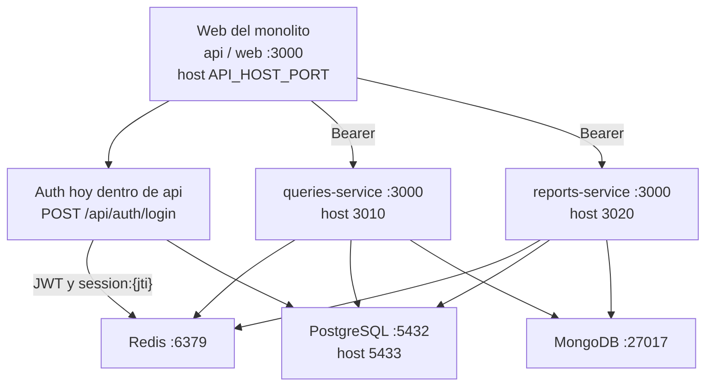

# Arquitectura — aporte de consultas, reportes, Redis y Docker

La web no habla con las bases. Entra al monolito, recibe un JWT y con ese token llama a consultas y a reportes. Esos dos servicios vuelven a comprobar el token contra Redis y leen PostgreSQL o MongoDB. Entre contenedores los nombres son `postgres`, `mongo`, `redis`, `api`, `queries-service` y `reports-service`.

Los servicios que el resto del equipo todavía no separó —usuarios, catálogo, proceso principal, documentos y notificaciones— siguen en `api`. Cuando salgan a su propio Dockerfile se agregan a la red `nexum` con el nombre acordado. No hace falta cambiar las claves `session:{jti}` ni `revoked:{jti}`.

## Puertos

| Contenedor | Puerto interno | Puerto en el host |
| --- | --- | --- |
| api / web | 3000 | `API_HOST_PORT` (3001 en el `.env` actual) |
| queries-service | 3000 | 3010 |
| reports-service | 3000 | 3020 |
| postgres | 5432 | 5433 |
| mongo | 27017 | 27017 |
| redis | 6379 | 6379 |
